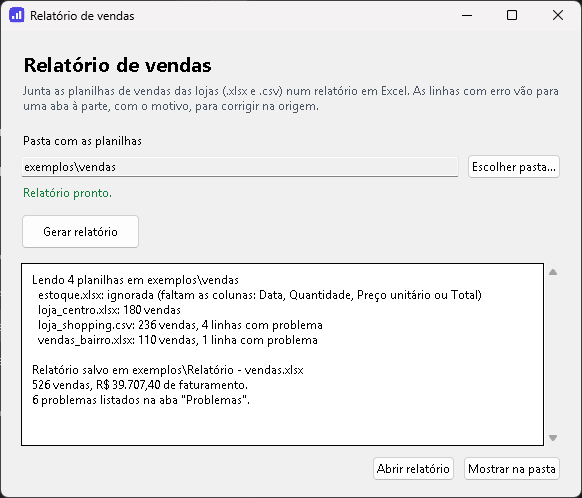

# Relatório de vendas a partir de planilhas

[](https://github.com/artvsantos/relatorio-planilhas/actions/workflows/ci.yml)
[](https://github.com/artvsantos/relatorio-planilhas/actions/workflows/windows.yml)

Cada loja manda a planilha de vendas de um jeito: uma em Excel com título
em cima, outra em CSV com "1.234,56", outra digitada à mão, só com o
total. Todo mês alguém passa horas copiando, colando e corrigindo antes
de conseguir ver quanto vendeu.

Esta ferramenta junta todas as planilhas de uma pasta e gera, em
segundos, um relatório em Excel pronto. As linhas com erro não são
descartadas em silêncio: elas vão para uma aba própria, com a planilha, a
linha e o motivo, para alguém corrigir na origem.

## Baixar para Windows

Para quem não programa, a ferramenta vem como um programa com janela, que
não precisa instalar nada:
**[baixar o RelatorioDeVendas.exe](https://github.com/artvsantos/relatorio-planilhas/releases/latest/download/RelatorioDeVendas.exe)**.



1. Clique em **Escolher pasta...** e escolha a pasta com as planilhas das
   lojas. Também dá para arrastar a pasta para cima do ícone do programa.
2. Clique em **Gerar relatório** e escolha onde salvar.
3. O relatório abre no Excel. Na janela fica o que foi lido de cada
   planilha e o que deu problema.

Na primeira vez, o Windows pode mostrar o aviso "O Windows protegeu o
computador", porque o programa é novo e não tem assinatura digital (que é
paga). Para abrir, clique em **Mais informações** e depois em **Executar
assim mesmo**.

## O que ela entende sozinha

- **Arquivos `.xlsx` e `.csv`**, inclusive o CSV do Excel em português
  (ponto e vírgula, acentos em cp1252) e o do Google Planilhas (vírgula,
  UTF-8).
- **Colunas com nomes diferentes**: "Qtd", "Qtde" e "Quantidade"; "Preço",
  "Valor unitário" e "Vl. unit."; "Data", "Dt. venda" e "DATA DA VENDA"...
- **Cabeçalho que não está na primeira linha**, com título, data de
  exportação e linhas em branco em cima.
- **Números no formato brasileiro e no americano**: `1.234,56`,
  `R$ 1.234,56`, `1234.56`.
- **Datas** em `27/10/2026`, `27/10/26`, `2026-10-27` ou como o número de
  série do Excel (quando a célula perde a formatação e aparece `46322`).
- **Só o total ou só o preço unitário**: um é calculado a partir do outro.
  Quando a planilha tem os dois e eles não batem, a linha vai para os
  problemas.
- **O mesmo produto escrito de jeitos diferentes** ("Caneca", "caneca",
  "CANECA") conta como um só.
- **Linhas em branco no fim**, arquivos temporários do Excel (`~$...`) e
  planilhas que não são de vendas esquecidas na mesma pasta.

## Exemplo

A pasta [`exemplos/vendas`](exemplos/vendas) tem quatro planilhas
bagunçadas de propósito, como as que chegam de verdade:

```
> python -m sales_report exemplos\vendas
Lendo 4 planilhas em exemplos\vendas
  estoque.xlsx: ignorada (faltam as colunas: Data, Quantidade, Preço unitário ou Total)
  loja_centro.xlsx: 180 vendas
  loja_shopping.csv: 236 vendas, 4 linhas com problema
  vendas_bairro.xlsx: 110 vendas, 1 linha com problema

Relatório salvo em relatorio.xlsx
526 vendas, R$ 39.707,40 de faturamento.
6 problemas listados na aba "Problemas".
```

O `relatorio.xlsx` gerado tem as abas:

| Aba | O que tem |
| --- | --- |
| **Resumo** | Período, faturamento, ticket médio, itens vendidos e o faturamento de cada loja, com gráfico |
| **Produtos** | Ranking dos produtos por faturamento, com a quantidade e a porcentagem de cada um |
| **Por mês** | Vendas e faturamento mês a mês, com gráfico |
| **Vendas** | Todas as vendas juntas, com a planilha e a linha de onde cada uma veio |
| **Problemas** | O que não entrou no relatório, e por quê |

E a aba **Problemas** do exemplo:

| Planilha | Linha | Problema |
| --- | --- | --- |
| estoque.xlsx | | arquivo ignorado: faltam as colunas: Data, Quantidade, Preço unitário ou Total |
| loja_shopping.csv | 16 | o total (R$ 999,00) não bate com quantidade × preço (R$ 39,80) |
| loja_shopping.csv | 43 | Produto vazio |
| loja_shopping.csv | 78 | Quantidade: "dois" não é um número |
| loja_shopping.csv | 121 | Data: "31/09/26" não é uma data válida |
| vendas_bairro.xlsx | 112 | Quantidade precisa ser maior que zero |

## Pela linha de comando

Com Python 3.12 ou mais novo:

```bash
python -m venv venv
venv\Scripts\pip install -r requirements.txt     # Linux/Mac: venv/bin/pip
venv\Scripts\python -m sales_report PASTA_COM_AS_PLANILHAS
```

Para escolher onde salvar: `-o relatorios\outubro.xlsx`. Se o relatório
estiver aberto no Excel, a ferramenta avisa em vez de dar erro. A janela
também abre pelo Python, com `venv\Scripts\python app.py`.

## Como o .exe é gerado

A cada mudança, o GitHub Actions gera o `.exe` com o PyInstaller e abre o
programa para conferir se a janela aparece. Numa tag de versão (`v1.0.0`),
ele também publica o `.exe` na página de
[Releases](https://github.com/artvsantos/relatorio-planilhas/releases). Para
gerar na sua máquina:

```bash
venv\Scripts\pip install -r requirements-build.txt
venv\Scripts\pyinstaller RelatorioDeVendas.spec
```

O programa sai em `dist\RelatorioDeVendas.exe`.

## Testes

```bash
pip install -r requirements-dev.txt
pytest --cov
```

Feito com TDD, com 100% de cobertura. A janela também é testada de
verdade, escondida e sem abrir diálogos: escolher a pasta, gerar o
relatório em segundo plano sem travar a tela, os erros e os botões. O CI
roda os testes no Windows e no Linux (numa tela virtual), do Python 3.12
ao 3.14.

## Feito com

Python · pandas · openpyxl · tkinter · PyInstaller · pytest · ruff ·
GitHub Actions

---

Precisa de uma automação parecida com as planilhas da sua empresa? Fale
comigo pelo [LinkedIn](https://www.linkedin.com/in/arthurvieira-dev) ou
pelo e-mail arthursantos334@gmail.com.
